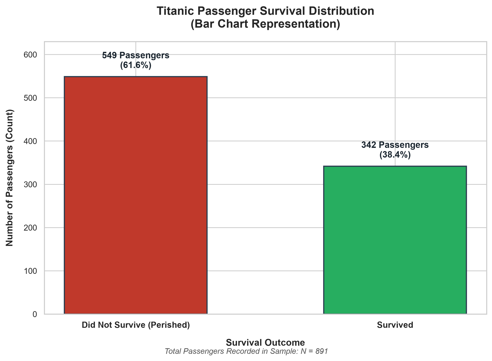
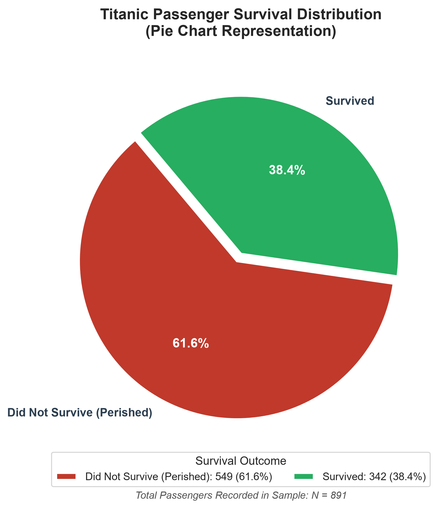

# Titanic Passenger Survival Visualization & Analysis

## Overview & Basic Description
This project analyzes the passenger survival distribution from the historical RMS Titanic voyage. The goal of this assignment is to explore the dataset, clean and prepare the relevant variables, and create two distinct visualizations—a **Bar Chart** and a **Pie Chart**—to evaluate how chart selection influences audience interpretation and cognitive perception.

---

## Dataset Source
* **Source:** The dataset was taken from the official Kaggle competition: [Titanic - Machine Learning from Disaster](https://www.kaggle.com/competitions/titanic) (`train.csv`).
* **Sample Size:** 891 passenger records.
* **Key Columns Used:**
  * `Survived`: Binary outcome (`0` = Did Not Survive, `1` = Survived)
  * `Pclass`: Socioeconomic passenger class (1st, 2nd, 3rd)
  * `Sex`: Passenger gender
  * `Age`: Passenger age in years
  * `Fare`: Ticket fare paid

---

## Project Structure
```text
main assig/
├── data/
│   └── train.csv                          # Kaggle Titanic training dataset (891 rows)
├── notebooks/
│   └── titanic_visualization.ipynb        # Data exploration, cleaning, and visualization code
├── charts/
│   ├── bar_chart.png                      # High-resolution (300 DPI) Bar Chart
│   └── pie_chart.png                      # High-resolution (300 DPI) Pie Chart
└── report/
    ├── titanic_visualization_report.docx  # 1–2 page Word reflection report
    └── titanic_visualization_report.md    # Markdown version of reflection report
```

---

## Key Findings & Visualizations

Out of 891 passengers in the sample:
* **Did Not Survive:** **549 passengers** (**61.6%**)
* **Survived:** **342 passengers** (**38.4%**)

### 1. Bar Chart (Figure 1)

* **Description:** Displays survival counts and percentages side-by-side along a shared horizontal baseline ($y = 0$).
* **Advantage:** Allows the audience to make precise, linear height comparisons. The 207-passenger deficit is immediately obvious within 200 ms.

### 2. Pie Chart (Figure 2)

* **Description:** Represents proportional shares as circular sectors of a 360-degree circle with percentage labels and an exploded slice for casualties.
* **Advantage:** Clearly communicates the part-to-whole relationship, showing that casualties formed the dominant majority (>60%).

---

## Conclusion: Which Chart is More Effective?
While the pie chart effectively conveys general majority share, the **bar chart communicates the information more effectively for quantitative analysis**. Grounded in Cleveland & McGill's graphical perception hierarchy, humans assess length along a common scale with far higher accuracy than circular angles or areas. The bar chart preserves exact counts and percentages without requiring trigonometric estimation.
